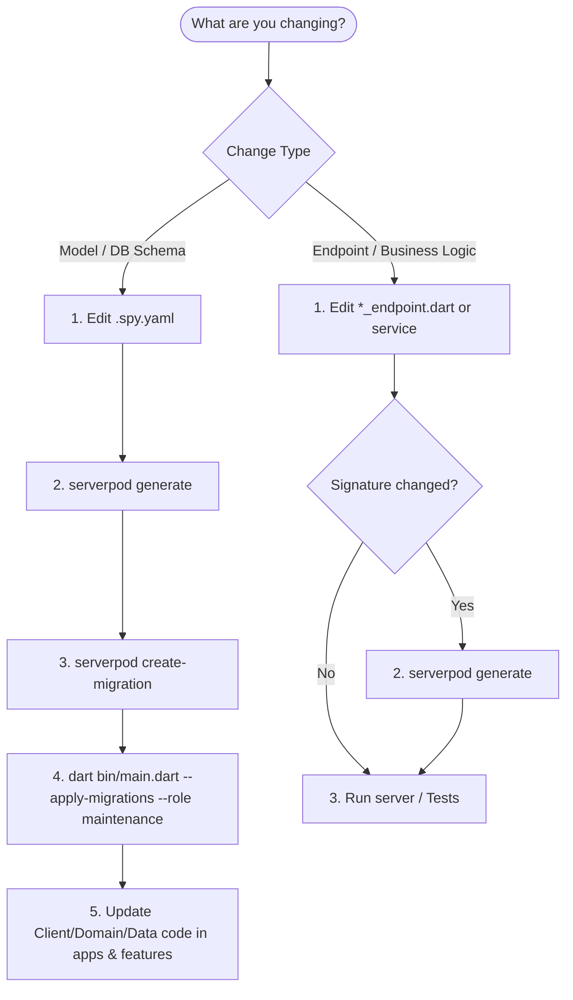

# Serverpod Development, Migrations, and Operations Guide

This document explains Serverpod server roles, database migration management, development workflows, and disaster/reset procedures for the E-Market backend.

---

## 1. Serverpod Server Roles

Serverpod provides different runtime execution roles for different operational contexts:

| Role | CLI Flag | Purpose / Behavior |
| :--- | :--- | :--- |
| **`monolith` / `server`** (Default) | (none or `--role monolith`) | Boots the full backend runtime: connects to Postgres/Redis, starts HTTP/WebSocket API listeners, serves static/web routes, and keeps running to handle incoming requests. |
| **`maintenance`** | `--role maintenance` | Boots the server runtime, connects to the database, executes one-off operational tasks (e.g. `--apply-migrations`, repair routines, maintenance scripts), and **exits immediately upon completion**. |
| **`insights`** | `--role insights` | Runs a dedicated service node for Serverpod Insights monitoring and logging aggregation. |

### Why use `--role maintenance`?
When running database migrations in terminal scripts, docker entrypoints, or CI/CD pipelines:
```bash
dart bin/main.dart --apply-migrations --role maintenance
```
The server will connect, run all pending SQL migrations, output the status, and **cleanly exit (code 0)** without keeping API listeners open or blocking the terminal/pipeline.

---

## 2. Feature Development & Modification Workflows

Depending on what you are changing in the backend, follow the corresponding workflow below.



### Flow A: Modifying or Adding Database Models (`.spy.yaml`)

Use this flow when adding/modifying tables, columns, indexes, or relations in `backend/emarket_server/lib/src/**/*.spy.yaml`:

1. **Update `.spy.yaml`**: Define your model fields, table names, and foreign keys.
2. **Generate Dart Code**:
   ```bash
   cd backend/emarket_server
   serverpod generate
   ```
   *This generates Dart protocol DTOs and client-side representations in `backend/emarket_client`.*
3. **Create Database Migration**:
   ```bash
   serverpod create-migration
   # Or with a descriptive tag:
   serverpod create-migration -t add_product_variants
   ```
   *This analyzes schema differences and outputs SQL scripts in `backend/emarket_server/migrations/`.*
4. **Apply the Migration**:
   ```bash
   dart bin/main.dart --apply-migrations --role maintenance
   ```
5. **Update Consumer Packages**: Update repository mappings in `features/<feature_name>/` if DTO structures changed.

---

### Flow B: Modifying Server Endpoints & Logic Only (`.dart`)

Use this flow when changing endpoint methods, business logic, authorization rules, or services:

1. **Edit Endpoints / Services**: Modify `lib/src/**/*_endpoint.dart` or service classes.
2. **Synchronize Client (if endpoint signature changed)**:
   ```bash
   cd backend/emarket_server
   serverpod generate
   ```
   *(If you only changed internal method body implementation without altering endpoint method signatures, `serverpod generate` is not required).*
3. **Run or Test Server**:
   ```bash
   dart bin/main.dart
   ```

---

## 3. Hard Reset & Clean Regeneration Flow (Docker / Colima)

If you are iterating rapidly in development, have conflicting/messy migrations, or want to wipe the local database clean and generate a single fresh baseline migration:

### Step 1: Stop Containers and Delete Persistent Volumes
```bash
cd backend/emarket_server
docker-compose down -v
```
*(The `-v` flag removes the Docker volumes: `emarket_server_emarket_data` and `emarket_server_emarket_test_data`).*

### Step 2: Delete Old Migration Files
```bash
rm -rf migrations/*
```

### Step 3: Regenerate Protocols & Create Baseline Migration
```bash
serverpod generate
serverpod create-migration
```

### Step 4: Start Clean Database & Apply Fresh Migration
```bash
docker-compose up -d
dart bin/main.dart --apply-migrations --role maintenance
```

---

## 4. Useful Commands Quick Reference

### Melos Workspace Shortcuts

| Action | Melos Command |
| :--- | :--- |
| **Start server (dev mode + seed)** | `melos run server:dev` |
| **Apply migrations & exit** | `melos run server:migrate` |
| **Wipe DB, apply migrations & exit** | `melos run server:reset` |
| **Wipe DB, apply migrations & start dev server** | `melos run server:reset:dev` |
| **Wipe & restart Docker containers only** | `melos run server:docker:reset` |
| **Generate DTOs & build_runner** | `melos run codegen` |

### Direct CLI Commands

| Action | Command |
| :--- | :--- |
| **Start Docker services** | `docker-compose up -d` |
| **Stop Docker services** | `docker-compose stop` |
| **Wipe Docker database & volumes** | `docker-compose down -v` |
| **Generate DTOs & endpoints** | `serverpod generate` |
| **Create new DB migration** | `serverpod create-migration` |
| **Apply pending DB migrations** | `dart bin/main.dart --apply-migrations --role maintenance` |
| **Start server in dev mode** | `dart bin/main.dart --apply-migrations` |
| **Run server unit/integration tests** | `dart test` |
